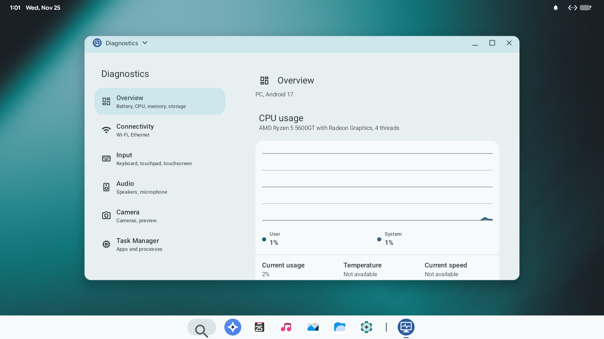
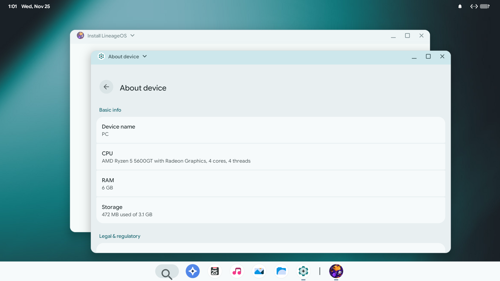

# PcDiagnostics

Hardware checks for LineageOS for PCs, in the style of ChromeOS Diagnostics: live CPU, memory, storage,
battery and network readings, testers for the keyboard, touchpad, touchscreen, speakers, microphone and
camera, and test suites that say what is wrong and what to do. Written from scratch
in Kotlin and Jetpack Compose (Material 3, wallpaper colors).

## What it shows

A navigation drawer (kept open on wide windows, behind a menu button on narrow ones) with:

- **Overview**: the device model and Android version, then one card each for
  - **Battery** (only when the PC has one): level, status (charging, on battery, fully charged), time to
    empty or to full, design capacity, health (full charge against design), cycle count and current.
    Test: charge test when plugged in, discharge test on battery (level read, 30 s wait, level read again).
  - **CPU usage**: model and threads, a 60-second user/system chart, current usage, temperature and speed.
    Tests: stress (every core runs the same computation for 20 s; every result must match), cache
    (cache-sized buffers written and read back in line order), floating point (identities and a bit-exact
    fingerprint per round) and prime search (sieve against the known prime counts).
  - **Memory**: used of total, with a bar. Test: patterns (zeros, ones, alternating bits, walking ones,
    addresses, pseudo-random) over a quarter of the free memory, within the app's heap.
  - **Storage**: used of total on `/data`. Test: writes 256 MB in the app's cache, syncs it, reads it back,
    compares and removes it; reports write and read speed and warns below 10% free.
- **Connectivity**: the active network (Wi-Fi or Ethernet): SSID, BSSID, signal, security, channel, IP
  addresses, gateway and name servers. Tests: local network (gateway answers), name resolution (server
  present, answers, under 400 ms), internet (the captive portal check page answers 204, under 1 s) and,
  on Wi-Fi, the link (signal not weak, network not open). A button opens the network settings.
- **Input**: one card each for keyboards, touchpads and touchscreens, every device with a **Test** button,
  then every input device with its kind, built-in or external, and vendor:product id.
  - Keyboard tester: the keyboard drawn key by key (US ANSI, ISO or Brazilian ABNT2; the default follows
    the system's country, ABNT2 in Brazil), with the chosen device's own legends. Held keys light up,
    pressed ones stay marked; keys are placed by scan code, by key code when there is none. It counts the
    keys pressed and shows the last key code. Only the chosen keyboard counts. Alt + Esc closes it.
  - Touchpad tester: a click on the area captures the pointer, so the touchpad sends its raw fingers; each
    finger draws a trace in its own color, with left, right and middle clicks counted. Esc closes it.
  - Touchscreen tester: the whole window is the drawing area, several fingers at once in distinct colors.
  - Tests: input devices (a keyboard and something to point with: touchpad, mouse or touchscreen) and
    keyboard keys (every key of the layout pressed in the last keyboard tester session).
- **Audio**: outputs and inputs from `AudioManager` (built-in, headphones, USB, HDMI, Bluetooth, line;
  casting, call and tuner endpoints left out), each list with the device to use.
  - Speakers: a test tone button per channel of the chosen output (left, right and every other channel
    of its widest channel mask). Test: a tone on each channel in turn; warns when the volume is off.
  - Microphone: record up to 10 s with a live level meter, then play the take back on the chosen output.
    Test: records 2 s; fails when it cannot record, warns on silence, reports the loudest sound.
- **Camera**: the cameras from `CameraManager` (front, back, external for USB, with the largest size and
  its megapixels), kept up to date as USB cameras come and go, and a live preview of the chosen one.
  Test: frames arrive and the picture is not dark (a covered lens), judged from the preview's frames
  after a second for the exposure to settle.
- **Logs**: saves the system logs to a zip file for a bug report (see "Saving logs for a bug report").
- **Task Manager**: opens PcTaskManager when it is installed.

Every test reports Passed, Warning or Failed with a sentence; "See report" lists them. "Stop test" cancels
the suite. Settings gets two tiles: **System > Diagnostics** and **Battery > Battery health**.

**Settings > About** gets three rows under the device name, each opening the overview:

- **CPU**: model, cores and threads (`/proc/cpuinfo`; cores are the distinct physical and core ids).
- **RAM**: total memory, rounded up to whole GB (the kernel keeps part of the installed memory).
- **Storage**: used and total on `/data`.

They are injected tiles (`com.android.settings.category.ia.my_device_info`, group `basic_info_category`)
on activity aliases of the main activity; their summaries come from `HardwareSummaryProvider`, which
Settings calls with the method in each row's `summary_uri` (`cpu`, `memory`, `storage`; `HardwareRow` in
core).

## Where the numbers come from

`/proc/stat`, `/proc/cpuinfo`, `/proc/meminfo`, `/sys/devices/system/cpu/cpu*/cpufreq/scaling_cur_freq`,
temperature from `/sys/class/thermal` and `/sys/class/hwmon` (package sensors first: `x86_pkg_temp`,
`coretemp`, `k10temp`, `zenpower`), the battery from `/sys/class/power_supply/*/uevent` (charge or energy
units), storage from `StatFs`, the network from `ConnectivityManager` and `WifiManager`, input devices
from `InputManager`/`InputDevice` (source mask, keyboard type, vendor and product ids, `isExternal`), key
events from the tester's window (`KeyEvent` scan code and key code), touchpad fingers from captured
pointer events (`SOURCE_TOUCHPAD`, scaled by the device's axis ranges), audio devices from `AudioManager`
(`AudioTrack` for tones and playback, `AudioRecord` for the microphone), and cameras from `CameraManager`
(`LENS_FACING`, YUV stream sizes) with the preview from CameraX. The captive
portal check page is the system's own (`captive_portal_https_url`, AOSP default otherwise).

## Saving logs for a bug report

Works without a network, so it is the way to report a Wi-Fi that does not work:

1. Plug in a USB drive (or use any folder the file picker offers).
2. Open **Diagnostics**, then **Logs** in the drawer, and press **Save logs**.
3. The file picker opens with a name like `lineage-pc-logs-20261126-1432.zip`; pick the USB drive and save.
4. Android asks whether Diagnostics may access all device logs: allow it. Refused, `logcat.txt` and
   `kernel.txt` hold only Diagnostics' own lines.
5. Wait for "Logs saved.", then attach the zip to the bug report.

The zip holds:

| File | Content |
| --- | --- |
| `logcat.txt` | `logcat -d -b all -v threadtime` (every buffer, the kernel's included) |
| `kernel.txt` | `logcat -d -b kernel`; `dmesg` when that fails or prints nothing |
| `getprop.txt` | `getprop` (every system property) |
| `modules.txt` | `/proc/modules` |
| `pci.txt` | every `/sys/bus/pci/devices` entry: vendor, device, subsystem ids, class, bound driver |
| `usb.txt` | every `/sys/bus/usb/devices` entry (devices and interfaces): ids, class, names, bound driver |
| `network.txt` | `/sys/class/net/*` (operstate, address, driver), `/sys/class/rfkill/*` (type, name, state, soft, hard), and Wi-Fi and Bluetooth enabled and state from `WifiManager` and `BluetoothAdapter` |
| `dumpsys-wifi.txt`, `dumpsys-bluetooth.txt` | `dumpsys wifi`, `dumpsys bluetooth_manager` |
| `build.txt` | fingerprint, display id, type, Android version, SDK, security patch, model, kernel version and `/proc/version` |

Every file is best effort: a collector that fails keeps what it wrote and its error (with the stack trace)
in its own file, and the other files are still written. Only a destination that fails (a USB drive pulled
out, a full disk) stops the save with "Could not save the logs.". The driver is the name the `driver` link
points to, `none` when nothing is bound.

## Permissions

`INTERNET`, `ACCESS_NETWORK_STATE`, `ACCESS_WIFI_STATE` (normal) and `NETWORK_SETTINGS` (signature,
granted by the platform certificate): with it `WifiManager` returns the SSID and BSSID without location
access. `RECORD_AUDIO` and `CAMERA` are runtime permissions: the Audio and Camera pages ask for them, and
once refused they point to the app's settings; the tests fail with that sentence until they are granted.
The microphone and camera features are declared optional, so the app installs on a PC without them.
`READ_LOGS` (logcat) and `DUMP` (dumpsys) are for the logs. They are signature|privileged permissions: a
privileged app gets them only when `etc/privapp-permissions-pcdiagnostics.xml` lists them, even with the
platform certificate, so that file lists both. With `READ_LOGS`, Android still asks the person before an
app reads all device logs (`LogcatManagerService`, the answer kept for a minute); refused, logd gives the app
only its own lines.
`largeHeap` gives the memory test room. The app defines
`org.lineageos.pcdiagnostics.permission.READ_HARDWARE_SUMMARY` (signature) as the read permission of
`HardwareSummaryProvider`; Settings runs as the system uid and passes it.

## Code

- `core/`: plain Kotlin, no Android. `SuiteRunner`/`SuiteState` (tests in order, worst outcome wins,
  cancel), the checks (`StressTest`, `CacheTest`, `FloatingPointAccuracyTest`, `PrimeSearchTest`,
  `MemoryTest`, `StorageTest`, `BatteryRateTest`, `LocalNetworkTest`, `NameResolutionTest`,
  `InternetConnectivityTest`, `WifiTest`, `InputDevicesTest`, `KeyCoverageTest`, `SpeakerTest`,
  `MicrophoneTest`, `CameraTest`), `ConnectivitySuite`, `InputSuite`, `BatteryInfo`, readers,
  `CpuMonitor`, `HardwareRow`, and for the new pages:
  - `Input.kt`: `InputDeviceInfo` and its kind from the source mask, `InputDevices` (list, scaling).
  - `Keyboard.kt`: `KeyboardLayout` (`US_ANSI`, `ISO`, `ABNT2`; rows of slots, cells in key units, scan
    code then key code lookup, layout per country) and `KeyboardState` (held, pressed, last key).
  - `Touch.kt`: `TouchSession` (a trace per finger, a free color per finger down, clicks per button).
  - `Audio.kt`: device kinds, `SpeakerChannel` (channel masks), `TestTone`, `AudioLevel` (dBFS, meter).
  - `Camera.kt`: `CameraFacing`, `CameraDescription`, `Cameras`, `Luma` (average of a Y plane).
  - `LogBundle.kt`: `LogBundle` (the zip, a part's error kept in its file, progress, the file name),
    `LogPart`, `CommandRunner` and `ProcessCommandRunner`.
  - `LogCollectors.kt`: `LogCollectors` (the files in order, from `LogSources`: sysfs and proc roots,
    commands, the app's radio and build fields), `SysfsTable` (`PCI`, `USB`, `NET`, `RFKILL`: one line per
    sysfs entry with its attributes and driver).
- `src/`: `DiagnosticsViewModel` (readings once a second while visible, one `SuiteController` per card,
  and one bench per device page), `SystemSource`, `NetworkReader`/`AndroidNetworkProbe`,
  `HardwareSummaryProvider` (Settings > About summaries), `InputBench`/`InputReader`,
  `AudioBench`/`AudioReader` (`AndroidTonePlayer`, `AndroidSoundRecorder`), `CameraBench`/`CameraReader`
  (`CameraFrames`), and the Compose UI in `ui/` (`InputPage` and `InputTesters`, `AudioPage`,
  `CameraPage`, `Permissions`), and `LogsBench`/`LogsReader` with `ui/LogsPage` (the logs zip).

## Tests

```sh
core/run_tests.sh                        # JUnit tests of core/, with external/kotlinc and JUnit from prebuilts
python3 -m unittest discover -s tests    # UI strings (both languages, same placeholders, no em dash), Settings rows, runtime permissions in the manifest, READ_LOGS and DUMP allowlisted
tools/typecheck.sh                       # compiles core + Compose UI against the prebuilts, CameraX and the Bluetooth module included (needs a previous build's out/)
```

In Soong: `PcDiagnosticsCoreTests` (`java_test_host`, `atest`-able).

## Build integration

- local manifest: `<project path="packages/apps/PcDiagnostics" name="android_packages_apps_PcDiagnostics" remote="pc" revision="lineage-24.0" />`
- `device.mk`: `PRODUCT_PACKAGES += PcDiagnostics` (pulls `privapp-permissions-pcdiagnostics.xml`, which
  allowlists `READ_LOGS` and `DUMP`)

## Not done yet

- Not built or run on a device yet: only the host tests and the Compose typecheck have run.
- The keyboard tester sees only the keys the system passes to apps: shortcuts the system keeps (Meta,
  Alt + Tab and the like) do not reach it.
- Raw touchpad fingers need the touchpad input stack of Android 14 and later, which reports
  `SOURCE_TOUCHPAD` events while the pointer is captured.
- The speaker test cannot hear the tone: it passes when every channel played, and the sentence asks to
  check any speaker that stayed silent.
- "Learn more" links and a help page.
- SELinux: the device is permissive. Enforcing needs `system_app`/`platform_app` read access to
  `sysfs_thermal`, hwmon and power supply nodes, and for the logs running `logcat`, `dmesg`, `getprop` and
  `dumpsys` and reading the PCI, USB, net and rfkill nodes; the rules are not written.
- The storage read speed comes from the page cache right after writing, so it measures memory more than
  the disk; the check is about data coming back intact.

## Screenshots

Taken in QEMU/KVM at 1920x1080 from the live ISO.



Diagnostics, overview page.



Settings > About device with the CPU, RAM and storage rows.

## Credits

- [LineageOS](https://lineageos.org) ([GitHub](https://github.com/LineageOS)): the base system and build this is part of.
- [Android Open Source Project](https://source.android.com): the platform, its APIs and build system.
- [Android Jetpack](https://developer.android.com/jetpack): Compose for the UI and CameraX for the camera preview, used as libraries.

Thanks to everyone behind these projects. Files taken from them keep their original licenses and copyright notices.
